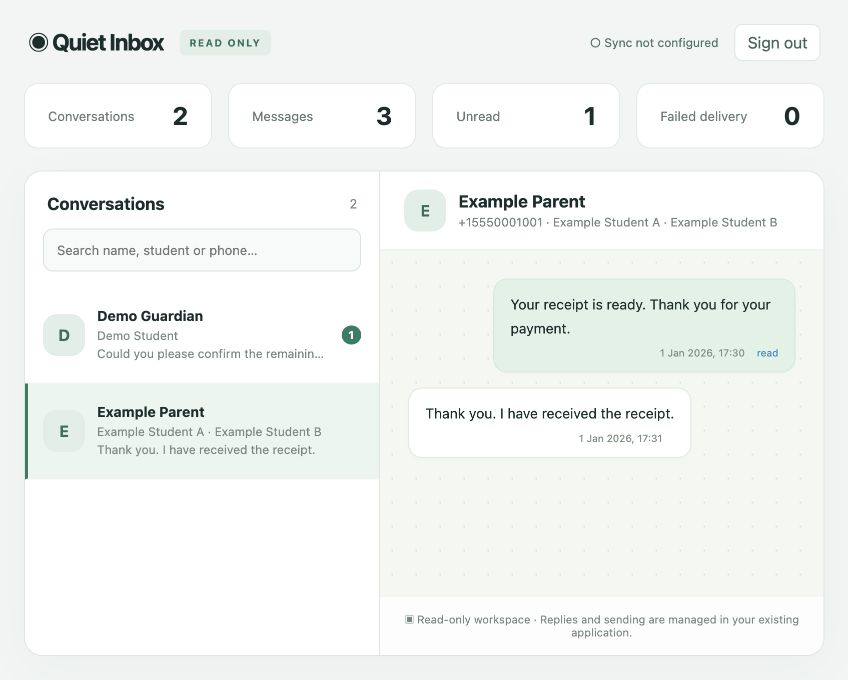
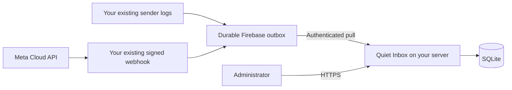

# ◉ Quiet Inbox
### A calm, read-only WhatsApp conversation dashboard

**Observe conversations. Keep your existing sender. Own your history.**

A lightweight React + Python + SQLite companion for applications already using the official WhatsApp Cloud API. Inspired by WhatsApp Web, without a reply box, campaign tools or credentials capable of sending messages.

> **Preview release:** local dashboard and durable synchronization primitives are implemented. Production Firebase capture and media synchronization are not yet activated. See the integration checklist before deployment.



## At a glance

| Experience | Included |
|---|---|
| Conversation browser | Responsive split pane, search, chronological messages |
| Shared family numbers | Multiple student labels per conversation |
| Delivery visibility | Accepted, sent, delivered, read and failed |
| Local unread tracking | Opening a conversation never sends a WhatsApp read receipt |
| Privacy | Administrator login, HTTP-only session, no public database |
| Reliability | SQLite transactions, replay deduplication, persistent checkpoints |
| Attachments | Private references, plus authenticated PNG/JPEG/PDF viewing when mirrored |
| Hosting | ARM64-compatible Docker, one persistent volume |



## Run locally

Requirements: Python 3.11+, Node 22+.

```sh
cd web
npm ci
npm run build
cd ..
export ADMIN_PASSWORD='choose-a-unique-long-password'
export COOKIE_SECURE=false
export PUBLIC_ORIGIN=http://localhost:3100
python3 -m server.app
```

Open `http://localhost:3100`. With no `SYNC_URL`, the dashboard starts empty. It never connects to Meta automatically.

## Docker deployment

```sh
cp .env.example .env
chmod 600 .env
# Edit all placeholder values; configure an HTTPS reverse proxy first.
docker compose up -d --build
```

Only loopback port 3100 is exposed. Put Caddy or Nginx with a trusted TLS certificate in front of it. Keep secure cookies enabled. Never expose an unprotected development instance publicly.

## Connect your application

`integrations/firebase-outbox.cjs` provides an opt-in Firestore outbox and authenticated feed handler. It does **not** register routes or modify your existing application by itself. Use a new dedicated sync secret (32+ random characters). See [architecture and rollout](docs/ARCHITECTURE.md) for event capture, retries, backfill and remaining steps.

A normalized message event:

```json
{
  "id": "message:example-001",
  "type": "message",
  "message_id": "example-001",
  "phone": "15550001001",
  "name": "Example Parent",
  "students": ["Example Student"],
  "direction": "in",
  "timestamp": "2026-01-01T12:00:00+00:00",
  "kind": "text",
  "text": "Thank you"
}
```

## Tests

```sh
python3 -m unittest discover -s tests -v
```

## Security and backups

- Do not provide this application with Meta access tokens.
- Use a unique administrator password and HTTPS. Login attempts are rate limited.
- Keep `.env`, database files, backups and real event payloads out of Git.
- Unread counts are shared dashboard state, not Meta read receipts.
- Back up SQLite using its backup API, not a live file copy that ignores WAL.
- Restarting the server signs administrators out; conversation history remains.
- The feed must export only the intended business account and exclude secret fields.

## Honest limitations

Historical messages only exist if your original application retained them. This project cannot recover arbitrary old WhatsApp chats. Attachments currently appear as references. The provided outbox needs explicit integration into your application's webhook and outgoing log capture. No claim of production readiness or zero Firebase usage charges is made.

## Credits and licence

Built on parsing components from [MarketingBoer/whatsapp-readonly-bridge](https://github.com/MarketingBoer/whatsapp-readonly-bridge), used under MIT. Original copyright is preserved in `upstream/LICENSE`. New dashboard code is MIT licensed. This project is independent of Meta and WhatsApp.
